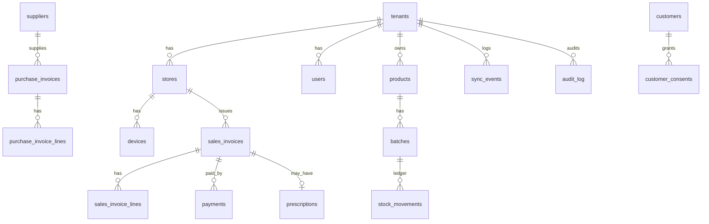

# Database Schema

SQL source of truth: `backend/db/migrations/001_init.sql` (tables) and `002_rls.sql` (RLS, immutability).
Local desktop schema: `frontend/src/lib/localSchema.sql`.

## 1. Conventions
- IDs: UUIDs generated **by the client** for synced entities (offline-safe).
- Every tenant table has `tenant_id uuid NOT NULL` and `UNIQUE (tenant_id, id)` so children can use composite FKs.
- Money: `numeric(14,2)`; rates `numeric(5,2)`; quantities: integer **base units**.
- Timestamps are `timestamptz` (UTC). Business dates (`invoice_date`, `expiry_date`) are `date`.
- Master data uses soft delete (`is_active`). Transactional tables are immutable once final.
- `hlc` text column on mutable master rows for last-writer-wins.

## 2. Entity map



## 3. Table groups

| Group | Tables | Notes |
|---|---|---|
| Tenancy | `tenants`, `stores`, `users`, `user_store_access`, `devices`, `subscriptions` | Store `code` and device `code` feed invoice series |
| Catalog | `products`, `batches`, `suppliers`, `customers`, `customer_consents`, `gst_rate_master` (global) | Batch unique on store+product+batch_no+MRP |
| Inventory | `stock_movements` (ledger), `stock_levels` (view) | No mutable stock column anywhere |
| Purchases | `purchase_invoices`, `purchase_invoice_lines` | OCR source tracked |
| Sales | `sales_invoices`, `sales_invoice_lines`, `payments` | Invoice no max 16 chars, unique per store |
| Compliance | `prescriptions`, `h1_register_entries`, `audit_log` | Retention per data class |
| GST | `gst_returns`, `e_invoices` | Filing status, ARN/IRN |
| Messaging | `outbox_messages` | Created only when consent exists |
| Sync | `sync_events`, `sync_counters` | Per-tenant monotonic seq |
| Ops | `backup_snapshots`, `ai_jobs` | |

## 4. Stock ledger

`stock_movements.qty_base` is signed:

| movement_type | sign | Created by |
|---|---|---|
| `opening` | + | Initial stock import |
| `purchase` | + | Purchase line (including free qty) |
| `sale` | - | Sales line |
| `sale_return` | + | Customer return or invoice cancellation |
| `purchase_return` | - | Return to supplier |
| `adjustment` | +/- | Stock count correction (reason + permission) |
| `expiry_writeoff` | - | Expired/damaged removal |
| `transfer_out` / `transfer_in` | - / + | Inter-store transfer |

`stock_levels` = `SUM(qty_base)` grouped by tenant/store/batch/product. Triggers block UPDATE and DELETE on the ledger.

## 5. Invoices and tax
A sales line stores `mrp`, `rate`, `discount_pct`, `taxable_value`, `gst_rate`, `cgst`, `sgst`, `igst`, `line_total`, `hsn_code`.
The header stores totals, `place_of_supply`, `buyer_gstin`, `round_off`, `grand_total`, `status` (`final` or `cancelled`).
Cancellation never deletes: set `status='cancelled'`, post reversing movements, write `audit_log`.

Confirm with your CA before coding: HSN digit requirements by turnover, invoice-series rules, B2C small/large classification, credit-note handling.

## 6. Row-Level Security
`002_rls.sql` loops over every public table with a `tenant_id` column:
```sql
ALTER TABLE t ENABLE ROW LEVEL SECURITY;
ALTER TABLE t FORCE ROW LEVEL SECURITY;
CREATE POLICY tenant_isolation ON t
  USING (tenant_id = NULLIF(current_setting('app.tenant_id', true), '')::uuid)
  WITH CHECK (tenant_id = NULLIF(current_setting('app.tenant_id', true), '')::uuid);
```
The app sets `app.tenant_id` via `set_config(..., true)` inside each transaction. If unset, queries return zero rows.
CI test: act as tenant A and assert no read or write of tenant B rows on **every** table.

### 6.1 DB roles
- `pharmacy_owner`: owns tables, runs migrations, never used by the app.
- `pharmacy_app`: runtime role, no BYPASSRLS, not superuser.
- `pharmacy_support_ro`: audited support access with explicit tenant impersonation logging.

## 7. Local SQLite schema (desktop)
Mirrors the business tables needed for one store, plus:
- `outbox(id, event_id, entity, op, payload, hlc, created_at, sent_at)`
- `sync_state(key, value)`: pull cursor, device id, last HLC
- `device_counters(name, value)`: invoice series counters
- `meta`: schema version, tenant/store ids

Money in SQLite is TEXT decimal strings (no decimal type). Do arithmetic in `decimal.js`, not SQL `SUM`.

## 8. Retention (confirm with counsel)
| Data | Handling |
|---|---|
| Sales/purchase invoices | Keep per GST and company-law requirements (verify period) |
| Schedule H/H1/X registers and prescriptions | Keep per Drugs & Cosmetics Rules (verify period) |
| Customer phone for reminders/marketing | Until consent withdrawn |
| Audit log | Long-term, hash-chained |
| OTP and session logs | Days to weeks |

## 9. Index checklist
- `products (tenant_id, lower(name))` plus trigram index
- `batches (tenant_id, store_id, product_id, expiry_date)` for FEFO
- `stock_movements (tenant_id, store_id, batch_id)`
- `sales_invoices (tenant_id, store_id, invoice_date)`
- `sync_events (tenant_id, seq)` and unique `(tenant_id, event_id)`
