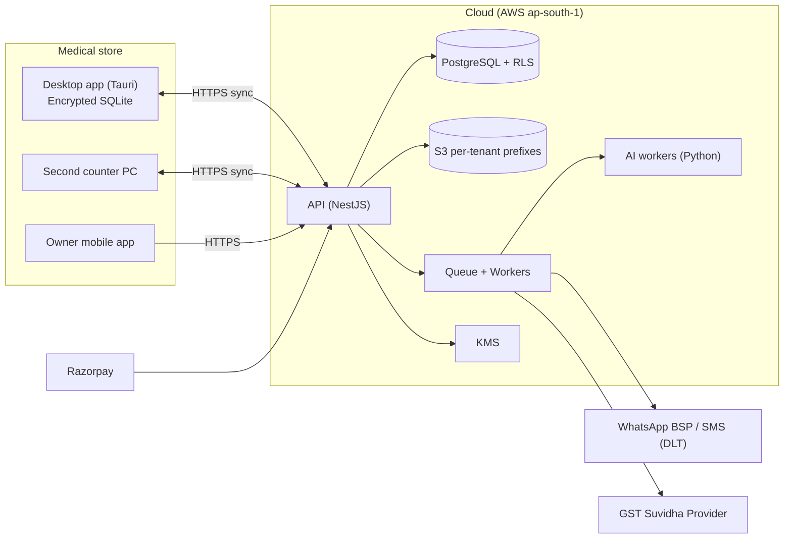
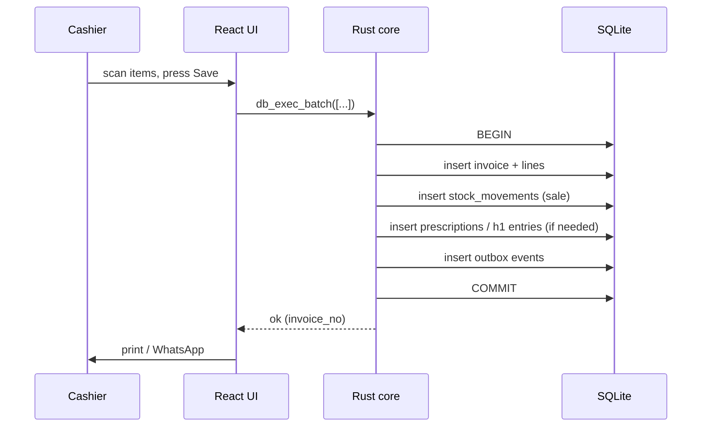
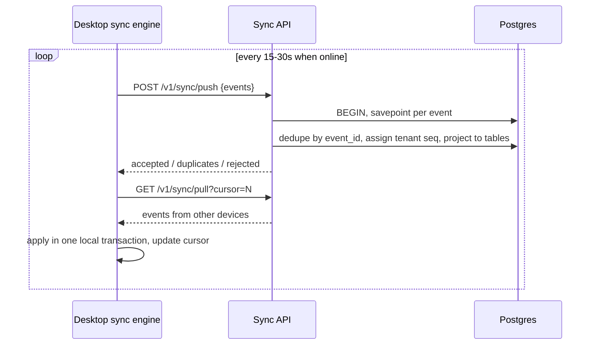
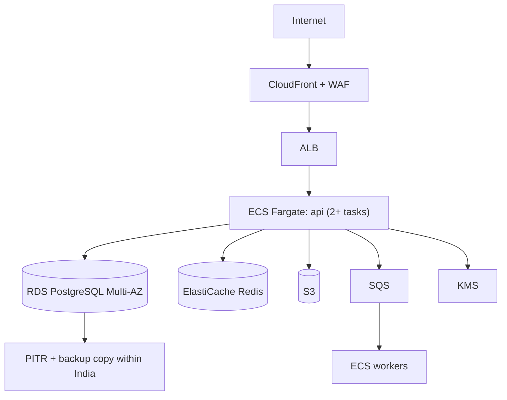

# System Design

## 1. Principles
1. **Local-first:** the shop never stops billing because internet or cloud is down.
2. **Shop owns data:** the encrypted local DB is the source of truth for that shop's daily operations.
3. **Cloud is a mirror plus services:** backup, multi-device sync, owner mobile app, GST filing, messaging, AI.
4. **Isolation by construction:** every row tagged with `tenant_id`, enforced by Postgres RLS and per-tenant keys.
5. **Ledger over state:** stock and money change only by appending events.

## 2. Context diagram

## 3. Components

### 3.1 Desktop app (`frontend/`)
| Part | Tech | Responsibility |
|---|---|---|
| UI | React, TS, Tailwind, TanStack Query | Billing, inventory, reports; keyboard-first |
| Core | Rust (Tauri commands) | Encrypted SQLite access, key handling, printing, hardware |
| Local DB | SQLite + SQLCipher | Source of truth for the shop, WAL mode |
| Sync engine | TS (calls Rust commands) | Outbox push, event pull, HLC, retries |
| Updater | Tauri updater | Signed updates, staged rollout |

### 3.2 Backend (`backend/`)
Modular monolith (NestJS). Modules:
`auth`, `tenants`, `devices`, `sync`, `inventory-read`, `billing-read`, `gst`, `messaging`, `licensing`, `backup`, `ai-gateway`, `admin`, `audit`.
Only `sync` writes business data coming from clients. Other modules read projections or run jobs.

### 3.3 Data stores
- **PostgreSQL 16** (15+ needed for `security_invoker` views). All tenant tables use RLS (`FORCE ROW LEVEL SECURITY`).
- **S3:** `s3://<bucket>/<tenant_id>/{prescriptions,invoices,backups,ocr}/...` with SSE-KMS.
- **Redis:** rate limits, OTP attempts, short-lived locks, BullMQ queues.

### 3.4 Workers
Messaging (WhatsApp/SMS), GST (returns, e-invoice), backup/snapshot, AI (OCR, forecasting), reconciliation (stock checks).

## 4. Flows

### 4.1 Billing (offline)

### 4.2 Sync (background)

## 5. Multi-tenancy model
- **Default (shared DB, shared schema):** `tenant_id` + RLS. Cheapest, fine for thousands of small shops.
- **Premium/chain option:** dedicated schema or database per tenant, same code path, chosen by `tenants.isolation_mode`.
- **Per-tenant encryption:** each tenant has a data key wrapped by KMS. Sensitive columns (customer phone, prescription images, GST credentials) are encrypted at application level with that key. Deleting the key = cryptographic erasure.
- **Composite FKs** `(tenant_id, id)` stop cross-tenant references even if app code is buggy.

## 6. Deployment (AWS, India)

- Environments: `dev`, `staging`, `prod` in separate AWS accounts.
- IaC: Terraform. Secrets: AWS Secrets Manager. Logs: CloudWatch + Grafana; Sentry for errors.
- The prod DB user for the app is **not** superuser and **not** table owner (otherwise RLS is bypassed).

## 7. Non-functional targets
| Area | Target |
|---|---|
| Offline bill save p95 | < 500 ms |
| Desktop cold start | < 5 s on 4 GB RAM / HDD PC |
| Installer size | < 60 MB |
| Sync lag (online) | < 30 s p95 |
| RPO / RTO (cloud) | 15 min / 4 h |
| API availability | 99.9% (billing unaffected by outages) |
| Scale target | 10k tenants, 30k devices, about 5M events/day |

## 8. Trade-offs
- **Tauri vs Electron:** Tauri is lighter with a stronger security model, but needs WebView2 (Windows 10+). Keep UI framework-only so a shell swap is possible.
- **Event log vs full-state sync:** event log chosen for stock correctness and auditability; cost is more storage and replay logic.
- **Monolith vs microservices:** monolith first; extract workers only when load demands.
- **`pg` + SQL vs ORM:** thin SQL helper keeps RLS and transaction control explicit.

## 9. Open design questions
1. Do chains need a central product/price master across stores?
2. Allow negative stock (sell before purchase entry)? Default: allowed with warning, configurable.
3. Multi-language invoice printing requirements?
